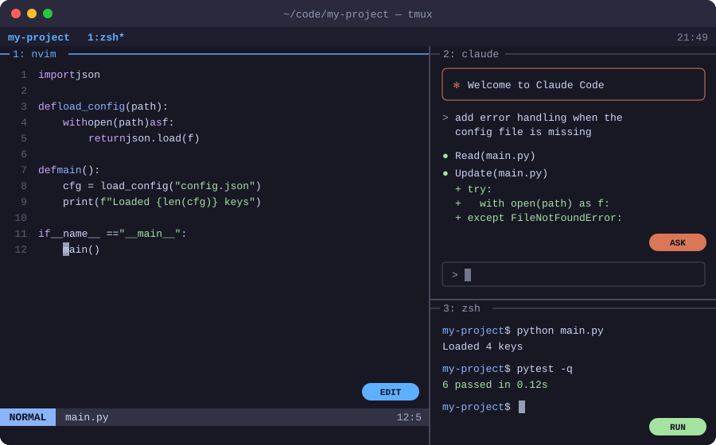
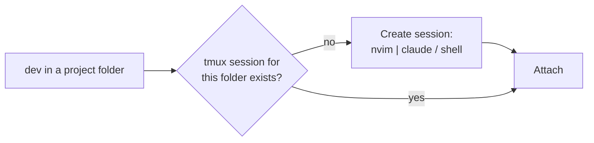

# dotfiles

My terminal coding setup for macOS: **Neovim** (based on [kickstart.nvim](https://github.com/nvim-lua/kickstart.nvim)) and **tmux**, plus a `dev` command that opens a three-pane workspace with an editor, [Claude Code](https://claude.com/claude-code) and a shell.



| Pane | What runs there | Use it to |
|---|---|---|
| **1 · left** (60%) | `nvim .` | Edit code |
| **2 · top right** | `claude` | Ask Claude Code to read and change the project |
| **3 · bottom right** | your shell | Run the code, tests, git, etc. |

All three panes start in the project directory.

---

## Set up a new Mac

**1. Install Homebrew** (skip if `brew --version` already works):

```sh
/bin/bash -c "$(curl -fsSL https://raw.githubusercontent.com/Homebrew/install/HEAD/install.sh)"
```

Then run the two `echo … >> ~/.zprofile` / `eval …` lines it prints at the end so `brew` is on your PATH.

**2. Clone this repo and run the installer:**

```sh
git clone https://github.com/abe1144/dotfiles.git ~/dotfiles
~/dotfiles/install.sh
```

`install.sh` is safe to re-run. It:

- installs everything in the [`Brewfile`](Brewfile): neovim, tmux, git, gh, ripgrep, fd, tree-sitter and two Nerd Fonts
- symlinks the configs into place (anything already there is renamed to `*.bak-<timestamp>`, not deleted):

  | Repo path | Linked to |
  |---|---|
  | `nvim/` | `~/.config/nvim` |
  | `tmux/tmux.conf` | `~/.config/tmux/tmux.conf` |
  | `bin/dev` | `~/.local/bin/dev` |

- checks that `~/.local/bin` is on your PATH and that Claude Code is installed

**3. Install Claude Code** (if the installer said it's missing):

```sh
curl -fsSL https://claude.ai/install.sh | bash
```

**4. Set a Nerd Font in your terminal** so icons render: Terminal → Settings → Profiles → Text → Font → *JetBrainsMono Nerd Font*.

**5. Open Neovim once** (`nvim`). Plugins install automatically at the versions pinned in `nvim/lazy-lock.json`. Wait for it to finish, then quit with `:q`.

Because the configs are symlinks, edits you make on any machine go straight into `~/dotfiles`. Commit and push them from there.

---

## Daily use

### Launch a workspace

```sh
cd ~/code/my-project
dev
```

or from anywhere:

```sh
dev ~/code/my-project
```



- Each project folder gets its own tmux session, named after the folder.
- Running `dev` again in the same folder **re-attaches** to your existing layout. Nothing is restarted.
- If you quit nvim or Claude, that pane drops back to a shell. Run `nvim .` or `claude` again to restart it.

### Leave and come back

tmux keeps everything running in the background, even after you close the Terminal window.

| Do this | Command |
|---|---|
| Detach (leave it running) | `Ctrl-a` then `d` |
| Re-attach | `dev` (in the same folder), or `tmux attach` |
| List running sessions | `tmux ls` |
| Switch between sessions | `Ctrl-a` then `s` |
| End a session for good | `tmux kill-session -t my-project` |

---

## tmux keys

The **prefix** is `Ctrl-a`: press `Ctrl-a`, let go, then press the key.

| Action | Keys |
|---|---|
| Move to another pane | Click it, or `Ctrl-a` then `h` / `j` / `k` / `l` |
| Move to another pane (no prefix) | `Option` + arrow keys ¹ |
| Zoom the current pane full-screen / back | `Ctrl-a` then `z` |
| Resize the current pane | Drag the border, or `Ctrl-a` then `H` / `J` / `K` / `L` (repeatable) |
| Split side by side | `Ctrl-a` then `\|` |
| Split top / bottom | `Ctrl-a` then `-` |
| New window (tab) | `Ctrl-a` then `c`. Switch with `Ctrl-a` then `1`, `2`, … |
| Scroll back | Mouse wheel, or `Ctrl-a` then `[` (`q` to exit) |
| Copy text | In scroll mode: `v` to start selecting, `y` to copy to the macOS clipboard |
| Send a real `Ctrl-a` (start of line) | `Ctrl-a` `Ctrl-a` |
| Reload tmux config | `Ctrl-a` then `r` |

¹ In Terminal.app this needs Settings → Profiles → Keyboard → **Use Option as Meta key**.

---

## What's in here

```
dotfiles/
├── bin/dev            # workspace launcher
├── nvim/              # Neovim config (kickstart.nvim fork)
│   ├── init.lua
│   ├── lazy-lock.json # pinned plugin versions
│   └── lua/custom/    # my own plugins and overrides
├── tmux/tmux.conf     # tmux config
├── Brewfile           # packages to install
├── install.sh         # installs packages and creates symlinks
└── docs/layout.svg    # the diagram above
```

### Customising

- **Pane sizes / what runs in each pane:** edit [`bin/dev`](bin/dev). The `-l 40%` and `-l 35%` values set the right column's width and the shell pane's height.
- **tmux prefix or keys:** edit [`tmux/tmux.conf`](tmux/tmux.conf), then press `Ctrl-a` `r` to reload.
- **Neovim plugins:** add files under `nvim/lua/custom/plugins/`.

### Don't commit secrets

This repo is public. Keep API keys and tokens in files outside it, for example `~/.zshrc`, which isn't tracked here.
